# ESP32 Wireless Telemetry Prototype

An ESP32 reads a sensor, shows it on an OLED, and streams it over Wi-Fi to a laptop, which logs every packet to an SQLite database. I then ran 18 range tests to measure how packet loss changes with distance and obstructions.

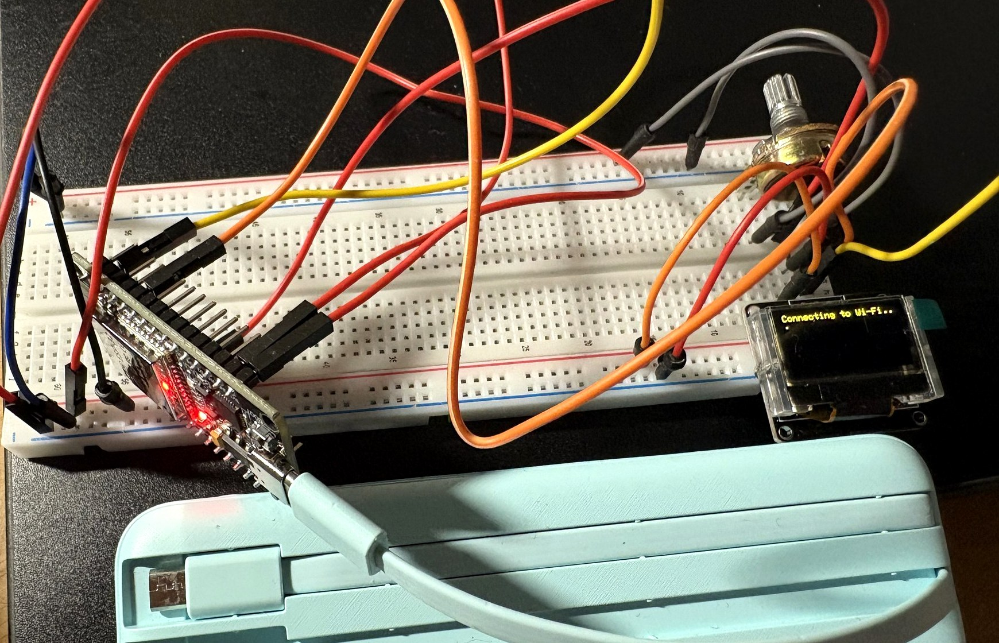

## Why I built this

On UW Formula Electric I'm working on the redesign of the car's **Telematics Communication Unit (TCU)**, the box that sends vehicle data wirelessly to the team for live monitoring during a run and for analysis afterwards.

The previous TCU used a **cellular modem and SIM card**. That added a monthly cost, and it was unreliable at racetracks, where cell coverage is often weak or congested by everyone else at the event. The goal of the redesign is a vehicle-to-ground link that **doesn't depend on cellular**, compared on range, bandwidth, latency, reliability, RF interference, power, cost and how easily it fits into the car. The new design also has to handle **losing the link** and buffer data so nothing is lost for good.

Before comparing technologies on paper, I wanted real data on the simplest non-cellular option: plain Wi-Fi from a low-cost microcontroller. The questions I wanted to answer:

1. How far can a cheap Wi-Fi link go before data starts getting lost?
2. When it fails, does it fail gradually or in bursts?
3. What does that mean for the buffering and radio choices in the real TCU?

## What I did

- **Built a mini TCU:** an ESP32 that reads a sensor (a potentiometer standing in for a throttle sensor), shows live status on an I2C OLED, and sends every reading over Wi-Fi.
- **Built the ground station:** a Python logger on a laptop that receives every packet, numbers each test run, and stores it all in an SQLite database.
- **Made losses measurable:** every packet carries a sequence number, so any missing packet shows up as a gap and can be counted.
- **Ran a range test:** 6 test conditions (2 to 15 m in the open, plus 5 m and 10 m behind a closed door), 3 runs of 30 seconds each, 18 runs and about 8,300 packets in total.
- **Analyzed the results:** used SQL to calculate packet loss, signal strength and dropout length per run, and Python (matplotlib) to graph them.

The phone hotspot was only used as a local Wi-Fi access point. The ESP32 and laptop talked to each other directly over that local network, without going through the internet or the cellular network.

## How it works

```
[Potentiometer] --ADC--> [ESP32] --Wi-Fi (UDP)--> [Laptop: logger.py] --> [SQLite: telemetry.db] --> [plot.py: graphs]
[OLED display]  <--I2C--    |
                            └-- USB serial (UART): wired backup and debugging
```

1. The ESP32 reads the potentiometer (standing in for a throttle sensor) and its own Wi-Fi signal strength (RSSI).
2. It sends one small JSON packet over UDP about 17.5 times a second:
   `{"seq":120,"t_ms":8034,"throttle":25,"rssi":-54}`
3. The same line goes out over USB serial, and the OLED shows throttle, signal strength and packets sent.
4. `logger.py` on the laptop receives each packet and stores it in SQLite, one "run" per test session.
5. Every packet has a sequence number (`seq`), so lost packets show up as gaps.
6. SQL queries and `plot.py` turn the runs into results and graphs.

## Hardware

| Part | Use |
|---|---|
| ESP32-WROOM-32 dev board (CP2102, USB-C) | reads the sensor, sends data over Wi-Fi |
| 0.96" SSD1306 OLED (I2C, address 0x3C) | live status display |
| 10 kΩ potentiometer | stand-in for a throttle sensor (analog input) |
| USB power bank | powers the ESP32 during range tests |
| iPhone personal hotspot | the Wi-Fi network |
| Laptop | runs the logger and stores the data |

### Wiring

| From | To (ESP32) | Purpose |
|---|---|---|
| OLED GND | GND | ground |
| OLED VCC | 3V3 | power |
| OLED SCL | GPIO 22 | I2C clock |
| OLED SDA | GPIO 21 | I2C data |
| Potentiometer left leg | GND | |
| Potentiometer middle leg | GPIO 34 | ADC input (an ADC1 pin, so it still works with Wi-Fi on) |
| Potentiometer right leg | 3V3 | |

## Build progress

| | |
|---|---|
| 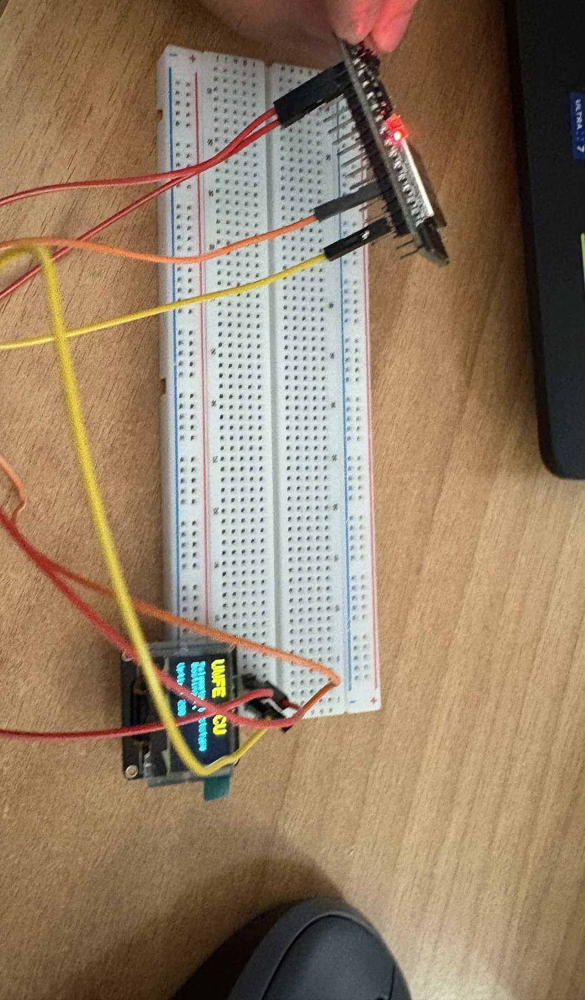 | 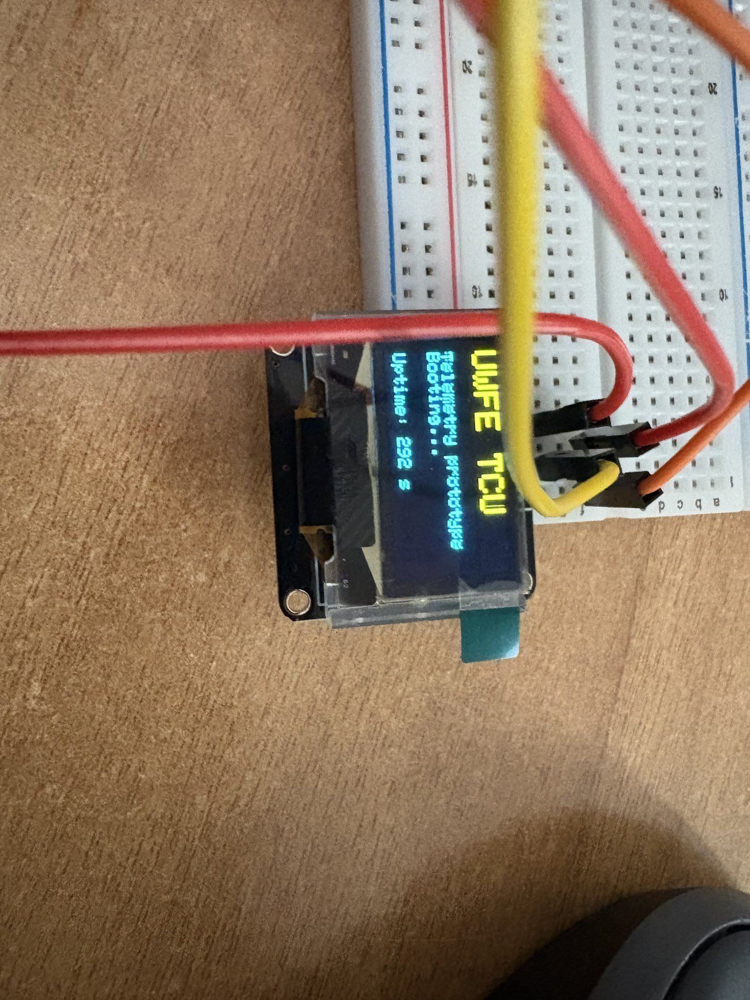 |
| 1. Wiring the OLED over I2C | 2. First text on the display |
| 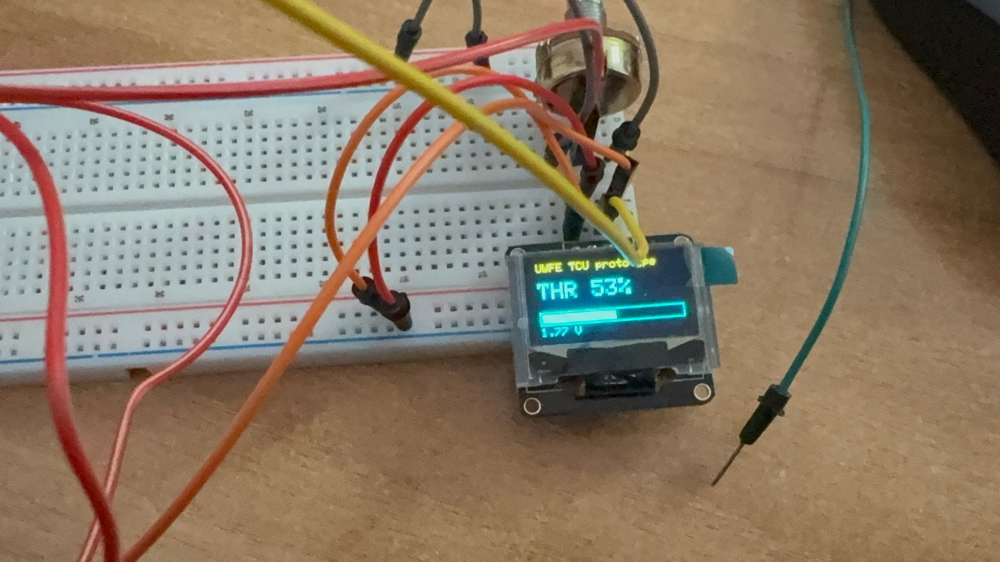 | 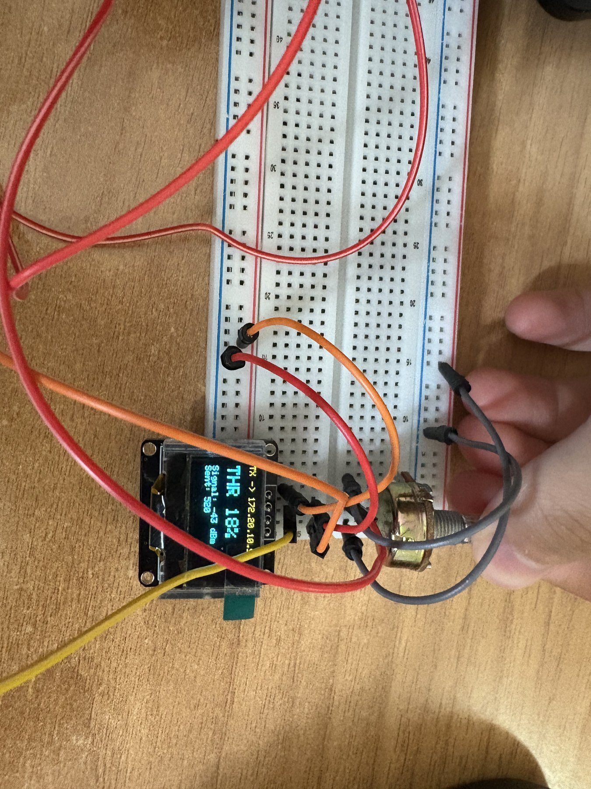 |
| 3. Potentiometer read through the ADC and shown as throttle % | 4. Turning the knob while streaming |
| 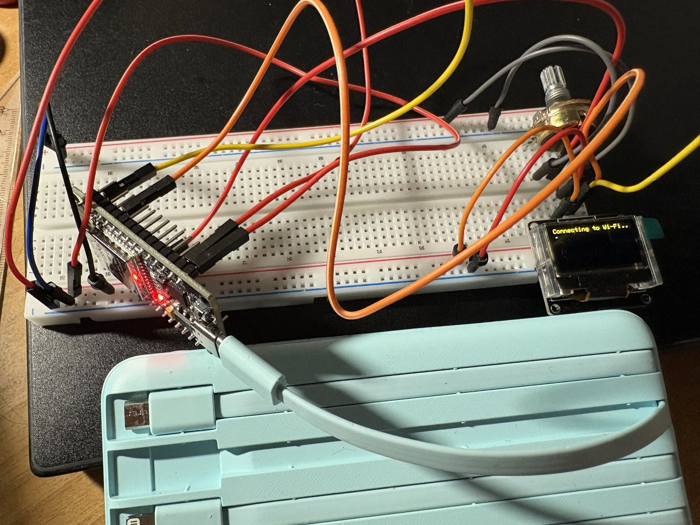 | 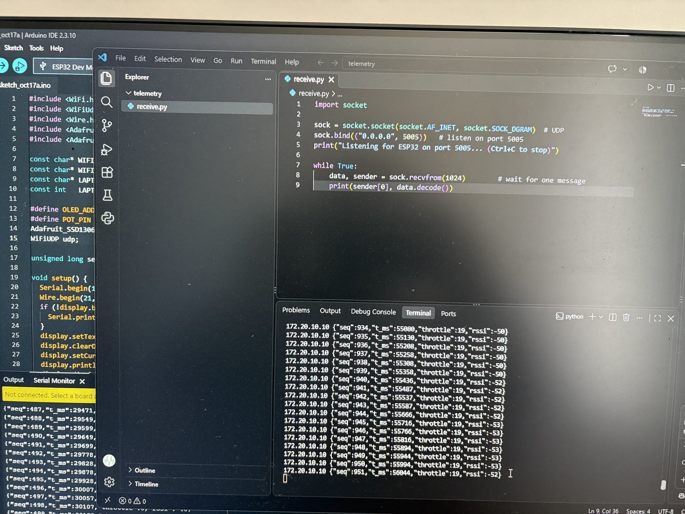 |
| 5. Running from a power bank and joining Wi-Fi | 6. Laptop receiving packets over Wi-Fi |
| 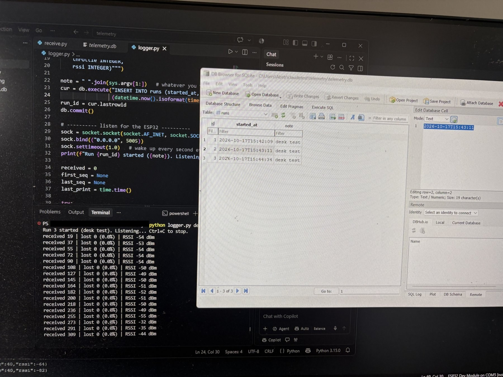 | 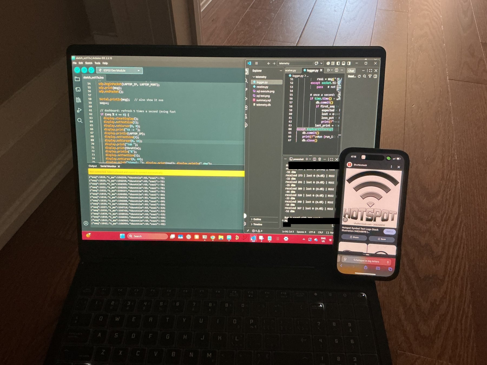 |
| 7. First run saved to SQLite | 8. Range test: laptop and hotspot stay in one spot |

## Range test

**Setup:** the laptop and the hotspot phone stayed in one spot. The ESP32 ran from a power bank and was placed at each distance, raised off the floor with nothing between it and the phone (except in the door tests). Distances were measured from the phone and are approximate.

**Method:** each test ran for 30 seconds (about 500 packets) and was repeated 3 times. 18 runs and about 8,300 packets in total.

### Results

| Test | Avg signal (RSSI) | % of all packets lost | Range across 3 runs | Longest dropout |
|---|---|---|---|---|
| 2 m | -64.7 dBm | 0.4% | 0 to 1.2% | 0.36 s |
| 5 m | -75.8 dBm | 0.1% | 0 to 0.2% | 0.13 s |
| 10 m | -75.0 dBm | 12.0% | 6.5 to 20.0% | 5.8 s |
| 15 m | -74.4 dBm | 0.3% | 0 to 0.8% | 0.31 s |
| 5 m, behind closed door | -67.8 dBm | 0.1% | 0 to 0.2% | 0.10 s |
| 10 m, behind closed door | -80.8 dBm | 42.7% | 19.1 to 77.0% | 4.2 s |

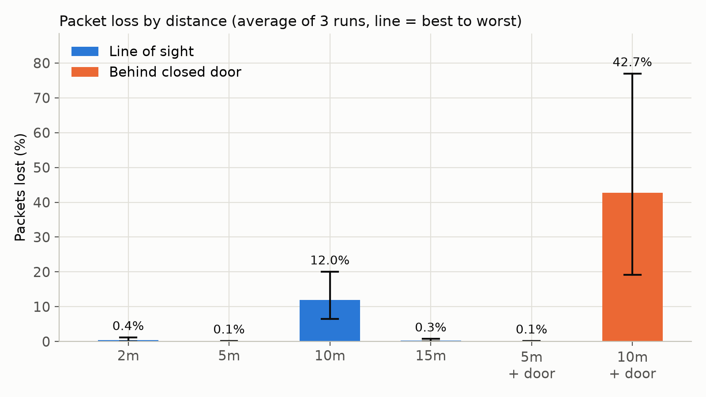

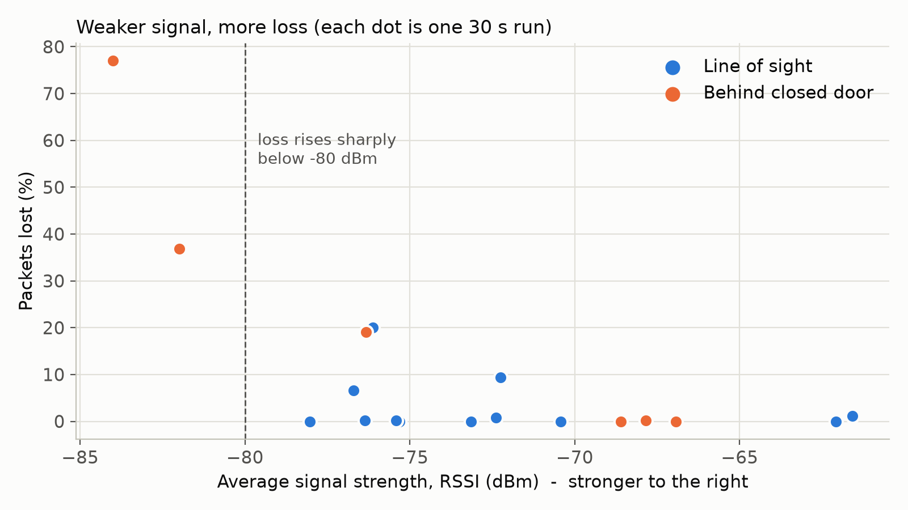

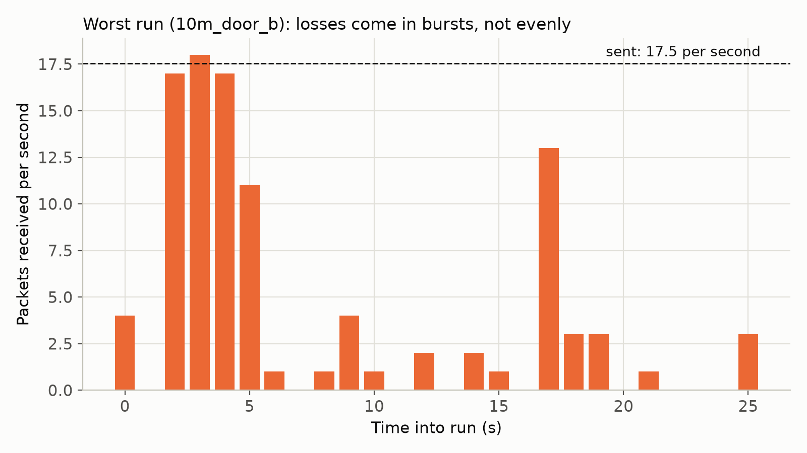

### What I found

- **At most positions up to 15 m, the link was solid:** 0.4% loss or less. The exception was one 10 m spot that averaged 12% loss.
- **Losses come in bursts, not evenly.** In the bad runs, some seconds received all 17 packets and others received none. The longest gap was 5.8 s. On a car that means seconds of missing data.
- **Loss goes up sharply once the signal gets weak.** The two worst runs averaged below -80 dBm and lost 37% and 77% of packets. Runs that lost 6 to 20% averaged around -72 to -77 dBm but had moments where the signal dipped to between -83 and -90 dBm.
- **Placement mattered more than distance.** My 10 m spot did worse than 15 m, and the 5 m door spot had a stronger signal than the open 5 m spot. Reflections and what is in the path change the signal more than a few extra metres.
- **What this means for the TCU:** basic Wi-Fi with the ESP32's on-board antenna lost data within 10 to 15 m indoors, far short of a racetrack. Dropping cellular means the new TCU needs a radio built for range (such as LoRa or a long-range 900 MHz link), an external antenna mounted high on the car, and a buffer on the car that stores data during dropouts of several seconds and resends it once the link comes back. Live monitoring can tolerate short gaps, but post-run analysis should get every packet.

### Limitations

- Loss is counted between the first and last packet received in each run, so a dropout at the very end of a run is not counted. The worst runs probably lost slightly more than shown.
- This was a single, controlled test that didn't account for other variables, and distances were estimated based on footstep size.
- RSSI is the ESP32's view of the phone's signal, not the other way round.

## Running it

**ESP32**
1. Open `esp32_telemetry/esp32_telemetry.ino` in Arduino IDE (board: ESP32 Dev Module).
2. Install the libraries **Adafruit SSD1306** and **Adafruit GFX** from the Library Manager.
3. Set `WIFI_NAME`, `WIFI_PASS` and `LAPTOP_IP` (your laptop's IPv4 from `ipconfig`), then upload.

**Laptop** (Python 3, laptop on the same network as the ESP32)
```
python laptop/logger.py 10m          # log one run, labelled "10m". Ctrl+C to stop
python -m pip install matplotlib
python laptop/plot.py                # make the graphs in results/
```
Open `results/telemetry.db` in DB Browser for SQLite and run `laptop/summary.sql` for a per-run summary.

## Files

| Path | What it is |
|---|---|
| `esp32_telemetry/` | ESP32 firmware |
| `laptop/logger.py` | receives packets and saves them to SQLite |
| `laptop/receive.py` | first test receiver that just prints packets |
| `laptop/plot.py` | makes the three graphs |
| `laptop/summary.sql` | per-run summary query |
| `results/` | database, CSV exports, graphs, and a screenshot of every run |
| `screenshots/` | SQL queries and results |
| `photos/progress/` | build photos, in order |
| `photos/range_test/` | photos from the range test |

## Next steps

- Repeat the same range test with a LoRa module to compare range and loss against Wi-Fi.
- Buffer packets on the ESP32 and resend them after a dropout.
- Add more sensors (temperature, IMU) and log a timestamp from the laptop to catch dropouts at the end of a run.
- Move the circuit onto a PCB.
